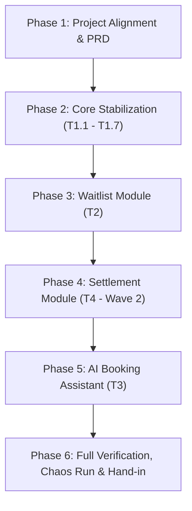

# Product Requirements Document (PRD) — SlotBook

---

## 1. Executive Summary & Objective

**SlotBook** is a modular booking and management platform designed for coaching centres. Members use the platform to discover class slots, book seats, manage subscription plans, and process cancellations and refunds in Indian Rupees (INR). Centre administrators use the platform to monitor class attendance, manage capacities, reconcile refunds, and audit instructor payout settlements.

The objective of this project is to stabilize core operations (T1), introduce an autonomous pluggable waitlist system (T2), deploy an AI conversational booking assistant (T3), and build a high-resilience instructor settlement module (T4) that withstands message delays, duplicates, and database disruptions.

---

## 2. System Architecture & Tech Stack

### 2.1 Backend (Java 21 / Spring Boot 3)
- **Modular Monolith**:
  - `core/`: Core domain logic (auth, members, plans, class batches/slots, bookings, refund calculation, Flyway schema migrations, and event dispatch).
  - `contract/`: Public domain interfaces (`CurrentMember`, `Slots`, `Bookings`, `Members`, `Notifier`, `CentreClock`) and events (`BookingConfirmed`, `BookingCancelled`, `PaymentRecorded`, `MemberMessage`). **External modules compile against this module exclusively.**
  - `modules/`: Pluggable feature modules (`reminders`, `waitlist`, `settlement`, `inbox`) loaded dynamically via Spring Boot AutoConfiguration (`META-INF/spring/...`).
  - `app/`: Executable Spring Boot packaging artifact bundling `core` with all active modules.
  - `chaos/`: Chaos runner test suite for resilience verification under simulated database failures and message broker delays.
- **Data Persistence**: PostgreSQL (embedded in-memory instance started on launch, migrations managed via Flyway).
- **Messaging & Events**: In-memory Apache ActiveMQ Artemis broker (JMS topics: `Topics.PAYMENTS`, `Topics.INBOX`) and internal Spring Application Events.

### 2.2 Frontend (React / Vite)
- **Architecture**: Single Page Application (SPA) in `web/` using React, native Fetch API (`api.js`), and modular UI slots (`web/src/modules/`).
- **Dev Server**: Proxies `/api` requests to backend `:8080`.

---

## 3. Scope & Detailed Requirements

```
                                  ┌────────────────────────────────────────────────────────┐
                                  │                 SlotBook Architecture                  │
                                  └──────────────────────────┬─────────────────────────────┘
                                                             │
            ┌────────────────────────────┬───────────────────┴────────────────┬───────────────────────────┐
            ▼                            ▼                                    ▼                           ▼
┌────────────────────────┐  ┌────────────────────────┐           ┌────────────────────────┐  ┌────────────────────────┐
│      T1: Core &        │  │     T2: Autonomous     │           │    T3: AI Booking      │  │     T4: Instructor     │
│       Front Desk       │  │        Waitlist        │           │       Assistant        │  │       Settlement       │
│     Stabilization      │  │         Module         │           │      (LLM / RAG)       │  │      Module (Wave 2)   │
└───────────┬────────────┘  └───────────┬────────────┘           └───────────┬────────────┘  └───────────┬────────────┘
            │                           │                                    │                           │
            ├─ T1.1 Timezone / Date     ├─ Contract-only compile             ├─ Natural language chat    ├─ JMS Topics.PAYMENTS
            ├─ T1.2 Notification format ├─ V200_1 Flyway schema              ├─ Member context only      ├─ V300_1 Flyway schema
            ├─ T1.3 Race condition lock ├─ REST Endpoints                    ├─ Tool calling             ├─ 70% net payout split
            ├─ T1.4 20h Refund policy   ├─ Auto-promotion on cancel          ├─ Ambiguity safety         ├─ Batch closing & immutability
            ├─ T1.5 MyPlan NPE fallback ├─ Admin purge                       └─ ASSISTANT.md docs        ├─ Idempotence & deduplication
            ├─ T1.6 Child booking design└─ Optional UI slot                                              └─ Chaos test resilience
            └─ T1.7 Paisa rounding
```

---

### Workstream 1: T1 — Front Desk Stabilization & Bug Triage *(Completed in Phase 2)*

All findings, fixes, and technical justifications are documented in `STATUS.md` (`T1.1` through `T1.7`).

| Item | Problem / Symptom Reported | Technical Root Cause Area & Fix Applied | Status |
| :--- | :--- | :--- | :--- |
| **T1.1** | Monday 5:00 AM yoga shows under Sunday; Today tab missing 5 AM class. | Replaced UTC `Clock` with `CentreClock` (`Asia/Kolkata`) in `SlotController` & `BookingController`. | Resolved & Tested |
| **T1.2** | Notification timestamps look messy with seconds. | Formatted with localized medium date / short time without seconds in `Notifications.jsx`. | Resolved |
| **T1.3** | 20-seat chess slot has 22 bookings; duplicate attendees in admin list. | Added slot-level synchronization lock in `BookingService.java` and partial unique index on `(slot_id, member_id) WHERE status = 'CONFIRMED'` in `V4`. | Resolved & Tested |
| **T1.4** | Cancellation 20 hours prior gave 50% refund instead of expected 90%. | Business cancellation policy requires $\ge 24$ hours for 90% refund. At 20 hours, 50% is the correct intended policy behavior. No code change needed. | Documented in `STATUS.md` |
| **T1.5** | New members get error screen when viewing "My Plan". | Added default plan assignment in `MemberRepository.insert`, fallback to default plan in `MeController`, and backfilled nulls in `V4`. | Resolved & Tested |
| **T1.6** | Parents asking to book classes for children from their account. | Investigated 1:1 member booking model. Documented architectural recommendation (dependents profile model vs sub-accounts) in `STATUS.md`. | Documented in `STATUS.md` |
| **T1.7** | Refunds off by 1 paisa; monthly totals do not match gateway statement. | Fixed `RefundCalculator` truncation to nearest-paisa rounding `Math.round(x * 100) / 100`, updated `AdminController` month boundaries, and reconciled 20 historical rows in `V4` (total ₹6,853.50). | Resolved & Tested |

---

### Workstream 2: T2 — Waitlist Module (`modules/waitlist/`)

An autonomous, pluggable module extending SlotBook via `contract/` without altering core code.

#### 2.1 Functional Requirements
1. **Joining Waitlist**: When a slot's capacity is full, an authenticated member can join the waitlist. If seats are available, joining is rejected with `409 Conflict`.
2. **FIFO Positioning**: Members are placed in a first-come, first-served queue with position tracking (`position = 1, 2, ...`).
3. **Queue Leaving**: A member can remove themselves from a waitlist at any time (`204 No Content`).
4. **Automatic Promotion**: When a booking is cancelled (`BookingCancelled` event received), the first eligible member on the waitlist is automatically booked into the freed seat via `Bookings.book(...)` and notified via `Notifier`.
5. **Idempotence & Redelivery**: Event listeners must tolerate duplicate event deliveries safely (Spring event redelivery is simulated in tests/runtime).
6. **Admin Management**: Admins can inspect waitlist rosters per slot and clear the entire waitlist for a slot.

#### 2.2 API Specification
- `POST /api/modules/waitlist/slots/{slotId}/join` (Member): Joins queue -> `200 {"position": N}` or `409 Conflict`.
- `DELETE /api/modules/waitlist/slots/{slotId}/me` (Member): Leaves queue -> `204 No Content`.
- `GET /api/modules/waitlist/slots/{slotId}` (Member): Views queue status -> `200 {"size": N, "myPosition": N | null, "entries": [...]}`.
- `GET /api/modules/waitlist/admin/slots/{slotId}` (Admin): Views slot queue -> `200 {"size": N, "entries": [...]}`.
- `DELETE /api/modules/waitlist/admin/slots/{slotId}` (Admin): Clears queue -> `204 No Content`.

#### 2.3 Verification Criteria
- All tests in `modules/waitlist/src/test/java/com/slotbook/modules/waitlist/WaitlistContractTest.java` pass (`./mvnw -pl modules/waitlist -am verify`).

---

### Workstream 3: T3 — AI Booking Assistant

A conversational assistant integrated into core enabling natural language operations.

#### 3.1 Functional Requirements
- **Chat Endpoint**: `POST /api/assistant/chat`
  - Input: `{"messages": [{"role": "user" | "assistant", "content": "..."}]}`
  - Output: `200 {"reply": "..."}`
- **LLM Provider**: Google Gemini API using `LLM_API_KEY` environment variable.
- **Context & Safety Isolation**:
  - The assistant must act strictly on behalf of the signed-in member (`CurrentMember`).
  - Strict guardrails: Assistant must never disclose or mutate other members' bookings or personal data.
  - Ambiguity handling: When user prompt is vague (e.g. "cancel my class" when user has multiple classes), assistant prompts for clarification.
- **Function / Tool Calling**:
  - `listClasses(from, to, date)`: View available classes.
  - `listMyBookings()`: Retrieve member's existing reservations.
  - `bookClass(slotId)`: Reserve a seat for the authenticated member.
  - `cancelBooking(bookingId)`: Cancel a reservation and trigger refund.
- **Documentation**: Provide `ASSISTANT.md` covering model selection, setup, usage guide, and security guardrails.

---

### Workstream 4: Wave 2: T4 — Settlement Module (`modules/settlement/`)

Instructors are paid from member class charges minus refunds. Build the settlement module in `modules/settlement/` adhering strictly to `contract/` and the new **Messages** JMS specification.

#### 4.1 Functional Requirements
1. **Message Subscription**:
   - Subscribes to `Topics.PAYMENTS` on ActiveMQ broker using container factory `Topics.LISTENER_FACTORY` and subscription name `"settlement"`.
   - Ingests `PaymentRecorded` messages (`kind` = `"CHARGE"` or `"REFUND"`, amount formatted as 2-decimal string).
   - Ingests messages idempotently: duplicates (matching `eventId`) must be silently ignored and never double-counted.
2. **Batching Lifecycle**:
   - Every few minutes (interval configured by `slotbook.settlement.interval-seconds`, default `300`), the settlement module closes a **batch** of all unclosed payments received since the previous batch.
   - Immediate manual batch closure via admin endpoint `POST /api/modules/settlement/admin/settle`.
   - Each payment event is settled **exactly once**, in the first batch closed after its arrival.
   - If there are no pending payments to settle, `settle` returns `{"batchId": null}` and does not create an empty batch.
   - **Immutability**: Once a batch is closed, its lines, totals, and event associations can never be modified.
3. **Instructor Payout Calculations**:
   - For each instructor with payments in the batch:
     - `charges`: Sum of member charges for this instructor in this batch (`BigDecimal`).
     - `refunds`: Sum of refunds for this instructor in this batch (`BigDecimal`).
     - `net`: $\text{charges} - \text{refunds}$.
     - `payout`: **70% share of net** (`net.multiply(new BigDecimal("0.70")).setScale(2, RoundingMode.HALF_UP)`).
   - All financial amounts in responses must be formatted as decimal strings in rupees with two decimal places (e.g., `"1354.50"`, `"121.91"`, `"862.82"`).
4. **Chaos & Database Failure Resilience**:
   - Must successfully survive message delays (up to 8 seconds), message duplicates, and intermittent database query/connection failures (`slotbook.chaos.db-failure-chance=0.03`).
   - If processing fails mid-stream, database transactions (`@Transactional`) guarantee consistency so no payments are lost, duplicated, or corrupted.

#### 4.2 API Specification (Admin Only)
All endpoints require admin authorization (`CurrentMember.requireAdmin()`).

| Method and Path | Response | Description |
| :--- | :--- | :--- |
| `POST /api/modules/settlement/admin/settle` | `200 {"batchId": 7}` or `200 {"batchId": null}` | Closes a new batch containing all pending payments. Returns null batchId if nothing pending. |
| `GET /api/modules/settlement/admin/batches` | `200 [{"id": 7, "closedAt": "..."}]` | Returns list of all closed batches, sorted oldest first (`ORDER BY id ASC`). |
| `GET /api/modules/settlement/admin/batches/{id}` | `200 {"id": 7, "closedAt": "...", "paymentEventIds": ["..."], "lines": [{"instructor": "...", "charges": "...", "refunds": "...", "payout": "..."}]}` | Returns full details of a closed batch, including all settled event IDs and per-instructor financial lines. |

#### 4.3 Database Schema (`db/modules/V300_1__settlement.sql`)
The module manages its own schema versioned under `300.x`:
- `settlement_payments`: Stores ingested payment messages (`event_id`, `payment_id`, `booking_id`, `slot_id`, `member_id`, `kind`, `amount`, `instructor`, `occurred_at`, `batch_id`).
- `settlement_batches`: Stores closed batches (`id`, `closed_at`).
- `settlement_batch_lines`: Stores aggregated instructor breakdown per batch (`id`, `batch_id`, `instructor`, `charges`, `refunds`, `payout`).

#### 4.4 Verification Criteria
- Pass the 600-payment chaos runner:
  ```bash
  .\chaos.cmd
  ```
- Record `T4` status and verification evidence in `STATUS.md`.

---

## 4. Governance & Audit Requirements

### 4.1 Corrections Log (`CORRECTIONS.md`)
- A continuous log must be maintained at the repository root documenting any AI interventions, incorrect assumptions, or corrected behaviors throughout development.
- Each entry follows:
  ```markdown
  ## <short title>
  What the AI did: <change or claim, with commit or file:line>
  How I noticed: <what was observed, run, or tested>
  What I did: <the correction applied and verification>
  ```

### 4.2 Status & Transcript Hand-in
- `STATUS.md`: Itemized log for issues `T1.1` to `T1.7`, `T2`, `T3`, and `T4`.
- Transcripts exported before hand-in via:
  ```bash
  node export-transcripts.mjs
  ```

---

## 5. Development & Execution Roadmap



1. **Phase 1: Alignment & PRD** *(Completed)*: Establish baseline requirements, contracts, and roadmap in `PRD.md`.
2. **Phase 2: T1 Front Desk Fixes** *(Completed)*: Fixed and tested T1.1 through T1.7; documented in `STATUS.md` and `CORRECTIONS.md`.
3. **Phase 3: T2 Waitlist Module**: Implement schema migration `V200_1__waitlist.sql`, service, event listeners, and endpoints in `modules/waitlist/`; verify with `WaitlistContractTest`.
4. **Phase 4: T4 Settlement Module (Wave 2)**: Implement schema migration `V300_1__settlement.sql`, JMS consumer on `Topics.PAYMENTS`, periodic batch closer, admin endpoints, and verify with `./chaos.cmd`.
5. **Phase 5: T3 AI Booking Assistant**: Implement `com.slotbook.core.assistant` tool-calling controller with Gemini API; document in `ASSISTANT.md`.
6. **Phase 6: Final Verification & Hand-in**: Run `./mvnw verify`, execute full `./chaos.cmd`, export transcripts (`node export-transcripts.mjs`), and prepare final commit.
